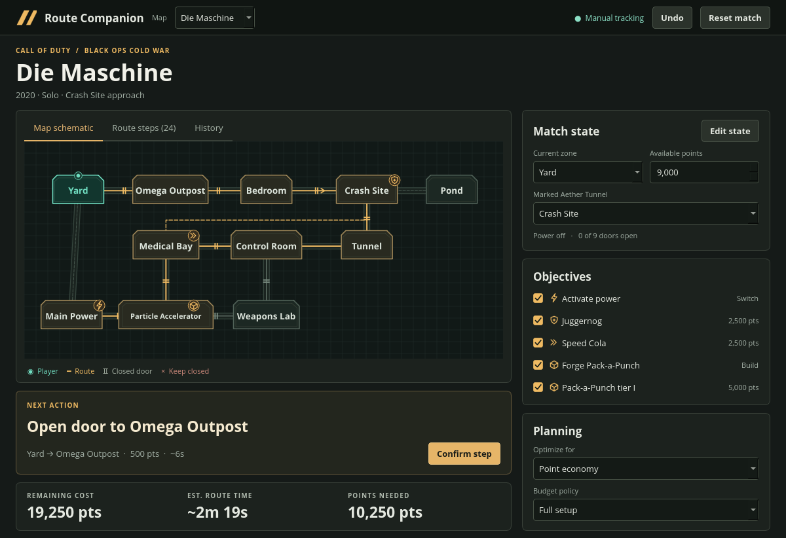
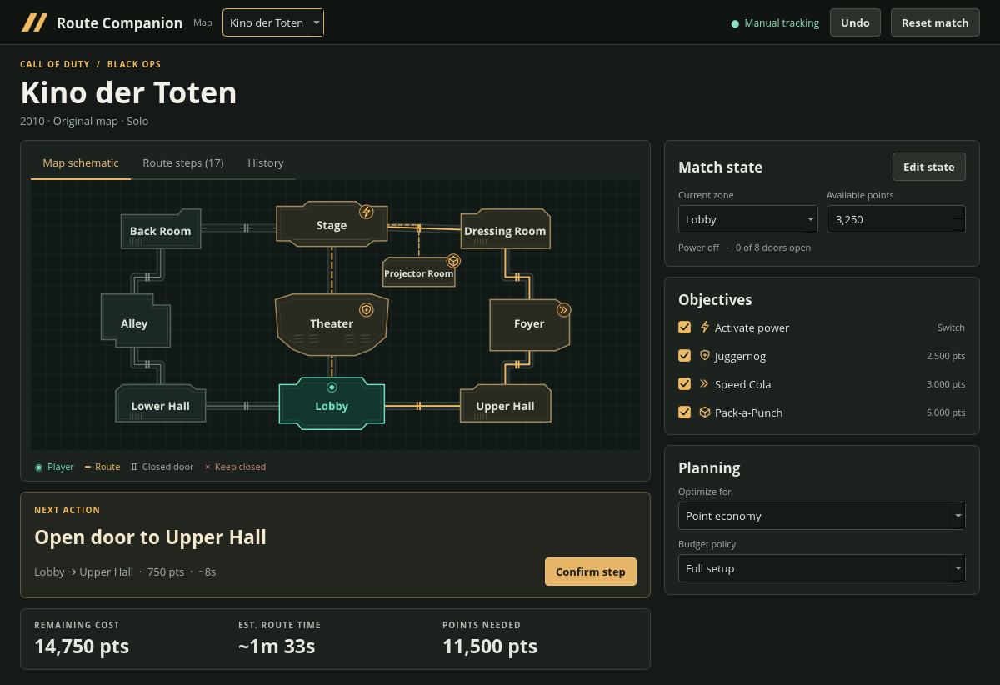

# Zombies Route Companion

A manual second-monitor planner for **Kino der Toten** in Black Ops and **Die Maschine** in Black Ops Cold War. Use the **Map** selector in the top bar to switch. Each map keeps its own solo match, objectives, door restrictions and undo history while the app is open. Set your location and points, choose your objectives, and follow the ordered route. Confirm a step after doing it in the game. The companion updates your balance, unlocks and next recommendation.



## Run the desktop app

Extract the ZIP and open a terminal in the directory containing `main.py`. Use Python 3.10 or newer.

**Windows PowerShell**

```powershell
py -m venv .venv
.\.venv\Scripts\python.exe -m pip install -r requirements.txt
.\.venv\Scripts\python.exe main.py
```

**macOS or Linux**

```sh
python3 -m venv .venv
.venv/bin/python -m pip install -r requirements.txt
.venv/bin/python main.py
```

The default installation uses PyQt6 and jsonschema. An existing environment with PyQt5 5.15 and jsonschema also runs the same interface. The solver and CLI need only Python and jsonschema. The app runs locally after installation.

## Try Die Maschine

Select **Die Maschine** in the top bar, or run `python main.py --map die-maschine`. You start in the Yard with 500 Essence. Choose **Activate power**, **Juggernog**, **Speed Cola**, **Forge Pack-a-Punch**, or **Pack-a-Punch tier I**. Forging and paying for an upgrade are separate objectives.

1. For an early purchase, select Juggernog alone. The modeled Crash Site route spends 2,250 Essence on access and 2,500 on the first perk. Juggernog works before main power.
2. Select **Forge Pack-a-Punch** in **Full setup**. While the marker is unknown the app plans the common prerequisite, reaching the accelerator anomaly. The summary is labeled **Cost to reveal**. It also reserves 500 Essence for the forthcoming tunnel. Other selected goals resume once the marker is known.
3. After entering the Dark Aether, set **Marked Aether Tunnel** to the surface area shown on your HUD. Crash Site routes to the Medical Bay part room. Pond routes to the Weapons Lab part room. The route charges 500 for the marked tunnel and takes the recovered part back to the accelerator. **Immediate** needs a marker for a full pre-forge plan. To compare scenarios in advance, choose either marker manually.
4. To join mid-match, use **Edit state** for opened doors, power, the two terminals, the part, the active visit and the forged machine. **Other perks held** counts every perk besides the two tracked by name. With Juggernog plus two other perks, Speed Cola is 4,000 Essence. Undo reverses a correction or a marker change.
5. The timed visit assumes the player can complete a normal trip. The planner schedules perk shopping outside that visit. Once the marker is known, it budgets for the tunnel and any planned door purchases through forging before recommending entry. If the visit expires, record your actual location and resume at the next in-game anomaly. A carried part can be retained across corrections.

| Solo objective on the modeled Crash Site approach | Spend from a fresh Yard spawn |
| --- | ---: |
| Juggernog as the first perk | 4,750 Essence |
| Main power | 8,250 Essence |
| Forge the machine with the corresponding lab route open on arrival | 8,750 Essence |
| First weapon upgrade, including that setup | 13,750 Essence |
| Both perks and a tier I upgrade, Crash Site marker | 19,250 Essence |

The graph covers the Yard–Omega Outpost–Bedroom entrance, the Crash Site and Pond, both underground lab approaches, and the powered Yard shortcut. The alternate Living Room surface entrance, Wunderfizz, free perk rewards, higher Pack-a-Punch tiers and the full Easter egg are outside this profile. The two Pond tunnel positions share a surface zone. Transit times are room-level estimates. The current-release perk count can include up to eight other perks.

The solo prices, part locations, power-dependent shortcuts and perk progression come from the following guides. Live timing and route playback remain to be validated in-game. [Solo doors and machine assembly](https://codzombified.blogspot.com/2020/11/packapunchdiemaschine.html) · [Tunnel locations and destinations](https://www.codzombieguides.com/die-maschine) · [Cold War perk rules](https://zfrr.me/hub/black-ops-cold-war-perks/) · [Yard shortcut](https://codzombified.blogspot.com/2020/12/die-maschine-map-layout-particle.html) · [Pond passage](https://www.reddit.com/r/CODZombies/comments/juxf3f/die_maschine_main_easter_egg_full_guide/)

## Try Kino der Toten



1. The app starts in the Lobby with 500 points and power and Juggernog selected. Set **Available points** to 3,250, then select Speed Cola and Pack-a-Punch.
2. In **Full setup**, the route costs 14,750 points. You can afford the first three upper-wing doors. The fourth needs another 1,000 points at that point in the route. Completing the entire plan requires another 11,500.
3. Complete the first door opening and move through it in-game. Click **Confirm step**. The companion moves you to the Upper Hall, records the door as open, and reduces your balance to 2,500. **Undo** restores the previous snapshot.
4. Use **Edit state** to mark a door open, preserve it with **Keep closed**, adjust power, report a lost perk, or enter a teleporter state. These corrections record observations without charging for purchases a second time. Zone changes leave door and perk observations intact.
5. Switch **Budget policy** to **Immediate** to require enough cash for the whole plan. If the plan exceeds your balance, the app shows the minimum additional points. The **Route steps** tab lists actions in execution order and shows cumulative funding. **History** records confirmed steps and manual corrections for the current session.

**Reset match** restores spawn, points, doors and utilities. Target and planning selections stay active. Reset is undoable. Closing the app ends the session.

## Routing and timing

Kino's profile defines ten zones and eight purchasable doors. Die Maschine's profile defines eleven zones, nine purchasable barriers and two Aether Tunnel destinations. The loader checks the JSON Schema and validates identifiers and references. A frozen world state captures room, opened doors, flags and remaining teleporter cooldown. A separate match value holds observed cash. The solver explores hypothetical transitions. Only confirmation or a correction changes the observed match.

| Mode | Ordering |
| --- | --- |
| Point economy | Lowest total spend, then lowest estimated duration |
| Speedrun | Lowest estimated duration, then lowest spend |
| Balanced | Weighted sum of spend divided by 1,000 and seconds divided by 30. The economy percentage controls the spend term. Ties use spend, then time. |

State-space Dijkstra includes acquisition order and one-time unlocks. An opened barrier is free to traverse in its supported directions. Speed and balanced searches with a cash cap keep multiple arrivals at the same state when one saves time and another saves points. Cooldown decreases during modeled actions. The solver prunes arrivals dominated on both the planning criteria and cooldown.

On Kino, the one-upgrade route initializes the pad on stage, links the lobby mainframe, returns to the stage, teleports and uses Pack-a-Punch in the projector room. The free outbound ride reserves 5,000 points for the upgrade. Setup mode flags that cash requirement before the ride. For an observed underfunded player already in the booth, the route returns to the lobby and accounts for cooldown before a later funded trip.

### Kino cost fixtures

From spawn with both wings closed, either four-door path to the switch costs 750 + 1,000 + 1,250 + 1,250 = **4,250 points**. Power opens the stage–theater and theater–lobby passages. The upper wing already reaches the Foyer, so adding Speed Cola to a multi-target upper-wing route requires only the machine price.

| Selected objectives | Minimum total spend |
| --- | ---: |
| Power | 4,250 pts |
| Juggernog | 6,750 pts |
| Speed Cola | 7,250 pts |
| One Pack-a-Punch upgrade | 9,250 pts |
| Power, Juggernog, Speed Cola and Pack-a-Punch | 14,750 pts |

### Verification

From the activated environment, run the following commands.

```sh
python -m unittest discover -v
python main.py benchmark
python main.py benchmark --map die-maschine
python main.py plan --map die-maschine --marker crash --goals power jug speed forged packed
python main.py plan --goals power jug speed packed --points 3250
python main.py plan --goals jug --zone stage --flags power --points 2500 --policy immediate
```

The tests also work with pytest. Desktop tests run through Qt's offscreen platform. Without Qt, the test runner reports those tests as skipped. Use `python main.py plan --help` for all observation and restriction options. Door, zone and flag IDs are in the map profile.

The packaged build passed **34 tests** on Linux, including eight desktop integration tests using PyQt5 5.15. The suite replays all 15 nonempty Kino objective combinations and both Cold War tunnel scenarios, checks hand-calculated costs, and exercises directed passages, shared doors, underfunded projector visits, Pareto pruning under a budget, invalid corrections, undo, reset and UI recalculation. One integration test confirms the full route through the window and finishes with every goal satisfied and zero points.

On the development machine with CPython 3.13, an all-target Kino setup search from spawn expanded 4,874 states in economy mode, 1,557 in speed mode and 4,273 in balanced mode. Median solver time over ten runs was approximately 43 ms, 10 ms and 44 ms respectively. These measurements exclude map loading and drawing. Run the benchmark for local timings.

## Profile scope and evidence

- Kino's room graph, door prices, perk prices, power gates and linking sequence were cross-checked against published original-map guides. Validation against recorded or live gameplay is pending. [Room layout](https://zfrr.me/hub/kino-der-toten-rooms/) · [Door cost walkthrough](https://gamefaqs.gamespot.com/ps3/960188-call-of-duty-black-ops/faqs/61611) · [Utilities and teleporter](https://zfrr.me/hub/kino-der-toten-teleporter-and-pack-a-punch/) · [Teleporter cooldown](https://mmmrkennedy.com/games/BO1/kino_der_toten/kino_der_toten_guide)
- The schematic shows connectivity. Travel durations are authored estimates, including one extra second the first time a door is opened. The displayed time excludes earning points, combat, detours and random return rooms. The booth assumes a fresh 30-second visit, a 6-second upgrade and a 60-second cooldown after return. Use **Edit state** if an observed timer differs. Route optimality applies to these modeled costs.
- The upgrade assumes the player carries an eligible weapon. This release tracks one upgrade and two perks. Recovery works by correcting lost perks and retaining opened doors and power.
- This release uses manual observations and runs independently of the game. Recorded-footage OCR, automatic tracking, global hotkeys and the map editor are future work. The source distribution was exercised using the PyQt5 fallback. A PyQt6 desktop run and Windows packaging remain to be verified.

## Source layout

| Path | Purpose |
| --- | --- |
| `main.py` | Desktop, CLI and benchmark entry points |
| `maps/` | Versioned Kino and Die Maschine JSON profiles and Draft 2020-12 schema |
| `companion/model.py` | Schema validation, actions and immutable state transitions |
| `companion/solver.py` | State-space Dijkstra, budgets and route results |
| `companion/session.py` | Observations, event history and undo |
| `companion/ui.py`, `schematic.py`, `style.py`, `qt.py` | Desktop controls, route visualization, styling and Qt bindings |
| `tests/` | Algorithm, state, cooldown and desktop integration tests |
